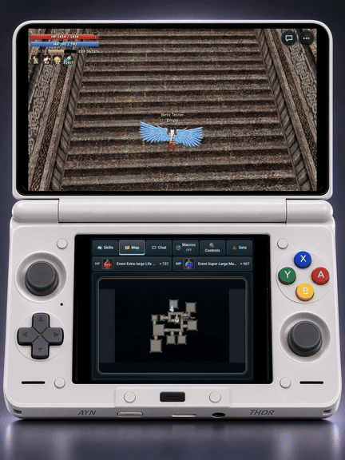

# Kaldora Thor

An Android companion for Kaldora on the AYN Thor. Firefox runs the game on the top screen. The bottom screen shows skills, macros, map, chat, controls, and equipment. Touch actions and controller input travel through a relay inside the APK. The player confirmed that the game and companion continued to work after disconnecting USB.

*The video shows an earlier build of the two-screen interface.*

## Setup

Download the current Android APK and Mozilla-signed Firefox extension from the [latest release](https://github.com/empy94/kaldora-thor/releases/latest). Install both once: the extension remains installed when Firefox or the console restarts. **Firefox for Android 142 or later** is required. The [installation guide in English and French](docs/INSTALL.md) explains each step.

Open **Kaldora Thor** to start both displays. If Firefox is missing, the launcher offers a direct link to install it. Firefox and the extension require separate confirmation. Sign in to Kaldora in Firefox if prompted. The first eligible interaction enters fullscreen. Launch from the APK again if the game page is reloaded. Use one Kaldora tab for the companion.

The APK keeps its own saved controller bindings, last panel, skill category, selected macro row, and selected effects setting. The game saves its settings and actual macro contents according to its own rules in Firefox. Updating the application over the same Android package preserves its data.

The Chat tab counts new player messages across game channels while another panel is open. Opening Chat clears the badge. System messages and outgoing whispers do not add to it.

## Build

Requires Node.js 22, Android SDK 35, build-tools 34.0.0, and JDK 19 or newer.

    node tools/build-firefox-extension.cjs
    .\build.ps1 -Sdk 'ANDROID_SDK_PATH' -Jdk 'JDK_PATH' -PublicRelease

The extension files are in `build/firefox-extension`. The APK is `build/Kaldora-Thor-Release.apk`. The Android package is `eu.kaldorathor.firefoxexp`.

## Game developer

- [Controller comparison](docs/CONTROLLER-COMPARISON.md) describes the player's layout and requested binding workflow.
- [Native movement test](docs/NATIVE-CONTROLLER-MOVEMENT-TEST.md) includes the confirmed diagnosis and a candidate game-side fix.
- [Native integration](docs/API-INTEGRATION.md) describes what the game can expose so the APK can work without the Firefox extension.

The app source is under the [MIT License](LICENSE). Kaldora artwork and other third-party assets belong to their respective owners.
