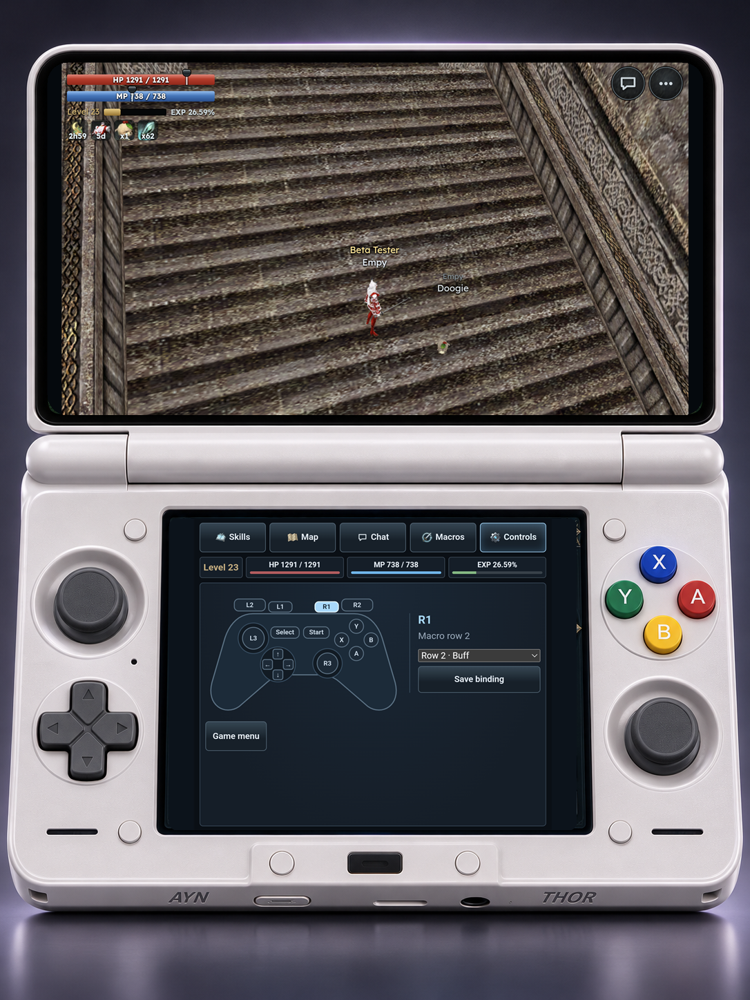

# Kaldora Thor

An independent Android companion for playing Kaldora on the AYN Thor. The game runs in Chrome on the upper display. The lower display shows game data and sends player-triggered actions through the local USB test bridge.

*Both displays were captured on a physical AYN Thor running Kaldora Thor 0.7. The console frame comes from the supplied reference.*

## Controls in 0.7

| Control | Action |
| --- | --- |
| **L3** | Cycle the target with Kaldora’s native targeting action. |
| **R3** | Basic attack using Kaldora’s native action. |
| **Start** | Open or back out of the game menu. |
| **D-pad, A, B** | Move the highlight, confirm, or go back in supported game menus and NPC dialogs. The Controls panel offers the same actions by touch while a game menu is open. |
| **L1** | Reserved. |
| **Select** | Toggle navigation of the lower panel. |

**Controls** shows the button being held and its current action. Press a configurable button, choose a skill or an available macro row, then select **Save binding**. **Skills** uses the game’s icons and cooldowns. **Macros** keeps the native rows and editable slots. Rows configured as buffs in Kaldora send the native buff command and need no enemy target. Each button and macro row can have one assignment at a time.

The lower Inventory tab is hidden for this version. Chat keeps its composer visible, and Map follows the character. Chrome requests fullscreen when focused gameplay is ready and the USB bridge is running. The APK uses English labels. The PC and USB debugging are required for live game data and actions.

## Build and run

Requirements: Windows, Node.js 22 or newer, Android SDK platform 35, build-tools 34.0.0, JDK 19 and ADB. Create a different local key on each private installation. Keep it out of Git and distribute locally built APKs only to the holder of that key.

    node -e "require('fs').writeFileSync('assets/usb-key.txt',require('crypto').randomBytes(32).toString('hex'),{flag:'wx'})"
    .\build.ps1 -Sdk 'ANDROID_SDK_PATH' -Jdk 'JDK_PATH'

Install the signed APK from build/Kaldora-Thor.apk, open it on the Thor and log in to Kaldora in Chrome. Run this command from the PC for the live lower display.

    .\tools\Start-UsbBridge.ps1 -Adb 'PATH_TO_ADB.EXE' -Serial 'THOR_SERIAL'

Kaldora game art and icons belong to their respective owners. This repository contains the companion source and presentation images.
