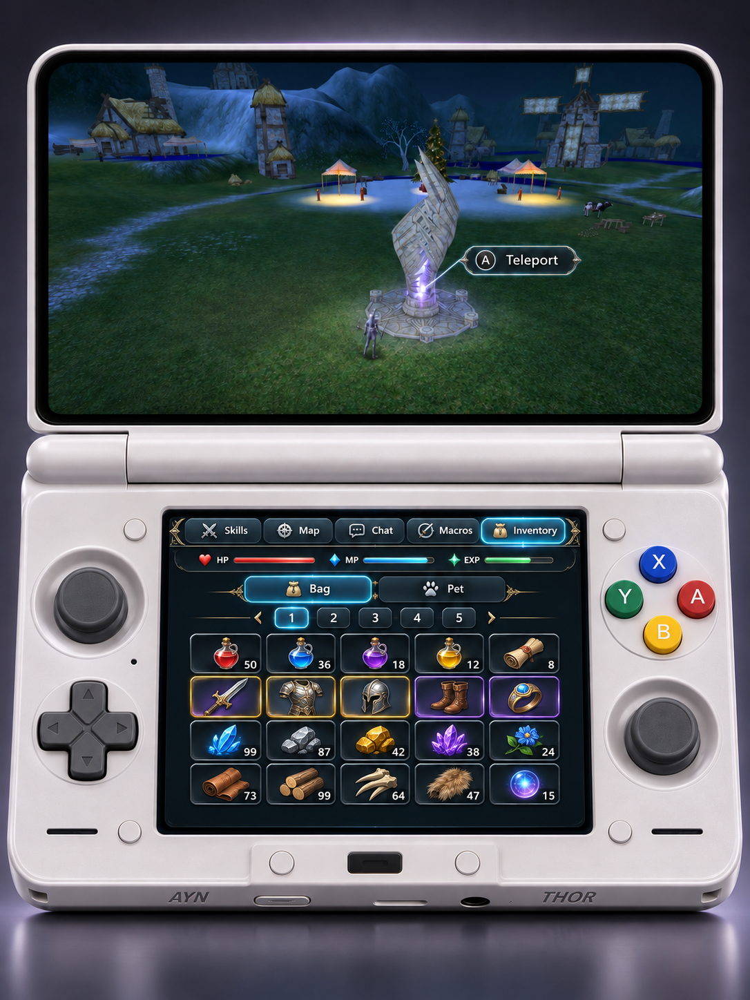
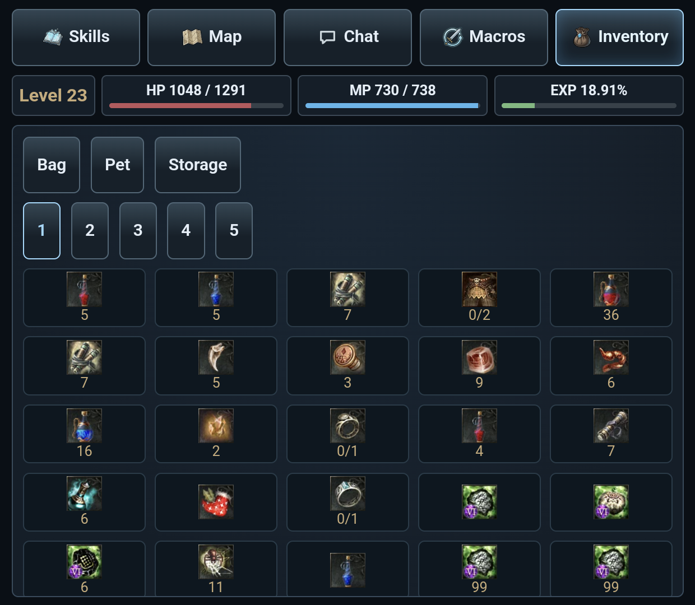

# Kaldora Thor

An independent Android companion for playing Kaldora on the AYN Thor. The game runs in Chrome on the upper display. The lower display shows game data and sends player-triggered actions through the local USB test bridge.

*Illustrative concept based on the supplied Thor mockup. The actual inventory capture is below.*

## Controls in 0.6

| Control | Action |
| --- | --- |
| **L3** | Cycle the target with Kaldora's native targeting action. |
| **R3** | Basic attack using Kaldora's native action. |
| **Start** | Open or back out of the game menu. |
| **D-pad, A, B** | Move the highlight, choose a button, or go back in supported menus and NPC dialogs. |
| **L1** | Reserved. It is omitted from skill and macro settings. |
| **Select** | Toggle navigation of the lower companion panel. |

**Skills** uses compact native icons and displays cooldowns. Use **Pick skill** and **Bind** to assign an equipped skill. **Macros** uses Kaldora's rows. Each row takes one button, and selectors exclude buttons already assigned to another row or the other section. **Inventory** displays live Bag, Pet and Storage tabs. The chat composer stays visible and **Map** follows the character automatically.

The APK and the game remain in English. The USB bridge needs the PC, USB debugging and a running Chrome session. Physical button mapping and combat still need hands-on confirmation across controller modes. The companion does not send commands without a player action.

## Build and run

Requirements: Windows, Node.js 22 or newer, Android SDK platform 35, build-tools 34.0.0, JDK 19 and ADB. Create a different local key on each private installation. Keep it out of Git and distribute locally built APKs only to the holder of that key.

    node -e "require('fs').writeFileSync('assets/usb-key.txt',require('crypto').randomBytes(32).toString('hex'),{flag:'wx'})"
    .\build.ps1 -Sdk 'ANDROID_SDK_PATH' -Jdk 'JDK_PATH'

Install the signed APK from build/Kaldora-Thor.apk, open it on the Thor and log in to Kaldora in Chrome. Run this command from the PC for the live lower display.

    .\tools\Start-UsbBridge.ps1 -Adb 'PATH_TO_ADB.EXE' -Serial 'THOR_SERIAL'

Kaldora game art and icons belong to their respective owners. This repository contains the companion source and presentation images.
